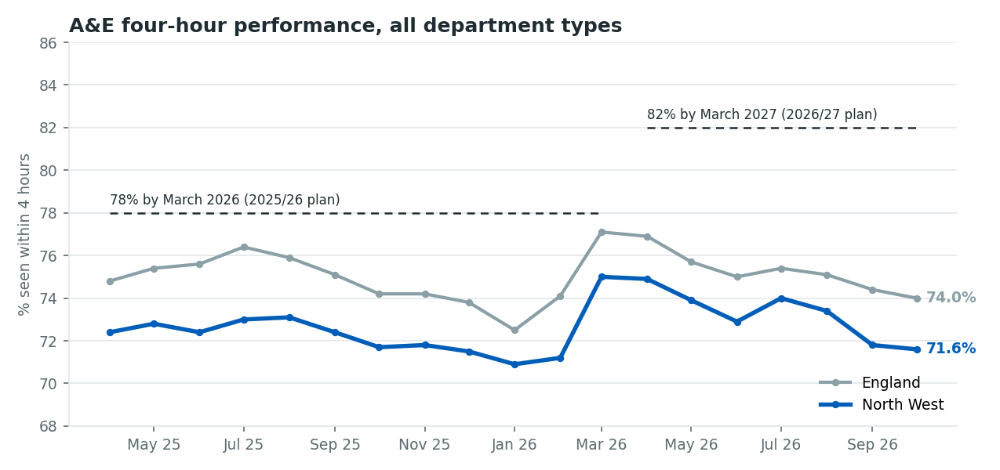
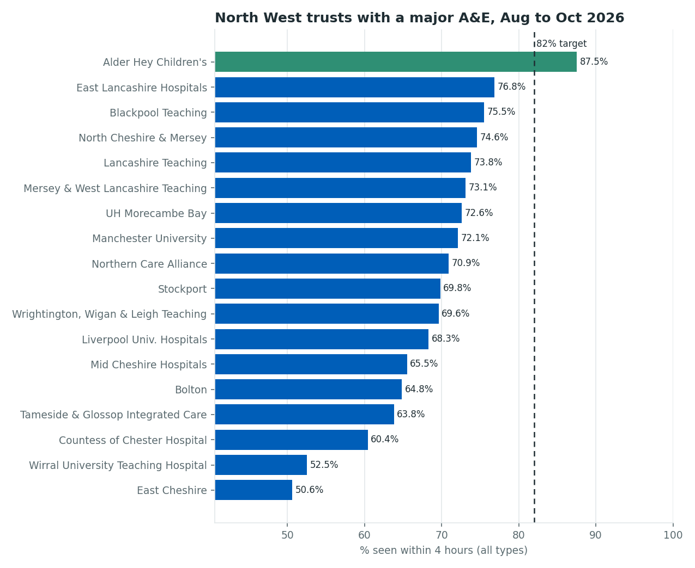
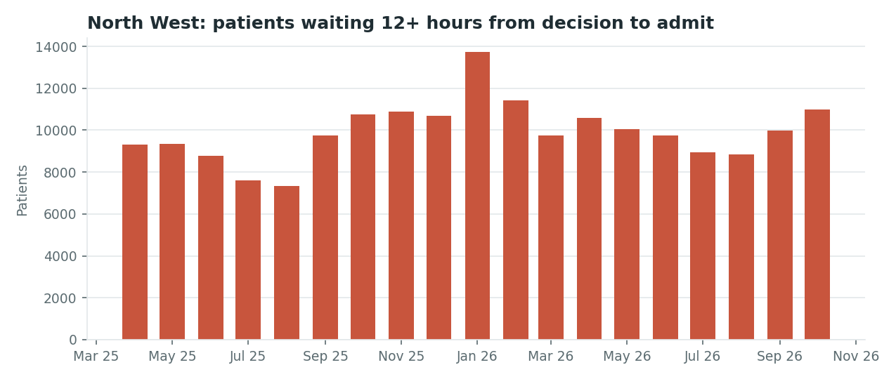
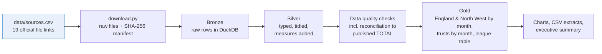

# NHS A&E Performance: North West

**How quickly are A&E patients in the North West being seen, and how does each trust compare? A tested pipeline built on NHS England's official monthly A&E statistics, checked against the national figures NHS England publishes.**


> **Data:** real, public data from NHS England's
> [A&E Attendances and Emergency Admissions](https://www.england.nhs.uk/statistics/statistical-work-areas/ae-waiting-times-and-activity/)
> statistics: 19 monthly files, April 2025 to October 2026. The pipeline downloads them itself, and a scheduled
> GitHub Actions run refreshes the analysis each month.

---

## The question

Trusts are measured against the four-hour standard: the share of A&E patients admitted, transferred or discharged
within four hours of arrival. NHS planning guidance set **78% by March 2026** and **82% by March 2027**.

1. Is the North West on track, and how does it compare with England?
2. Which North West trusts are closest to, and furthest from, the target?
3. How many patients are waiting 12 hours or more for a bed once the decision to admit them has been made?

## Headline findings (October 2026)

| | |
|---|---|
| **71.6%** of North West A&E patients seen within 4 hours, **2.4 points below England** (74.0%) | In major (Type 1) emergency departments: **57.7%**, against 60.1% for England |
| **March 2026:** the North West reached **75.0%** against the 78% target (England 77.1%) | **1 of 18** North West trusts with a major A&E met 82% over Aug to Oct 2026 |
| **10,980** patients waited 12+ hours from decision to admit, **up 236** on October 2025 | That is **18.2%** of emergency admissions via A&E, against **13.9%** for England |

Full write-up: **[docs/executive_summary.md](docs/executive_summary.md)**







**Reading the league table:** Alder Hey is a children's hospital, so its case mix differs from the general acute
trusts. Pooling three months stops one unusual month deciding a trust's position.

## Can the numbers be trusted?

Every run checks the data before any chart is drawn. The pipeline stops if a check fails.

| Check | Why it matters | Result |
|---|---|---|
| The period inside each file matches the month it was downloaded for | Catches a wrong or re-used file link | Pass |
| Each provider appears once per month | Catches double counting | Pass |
| All counts present, numeric and not negative | Catches broken or partial files | Pass |
| Patients over 4 hours never exceed attendances | Catches impossible values | Pass |
| **Sum of all providers equals NHS England's published national TOTAL row** | Proves nothing was lost or double counted in loading | Pass, all 19 months |
| Every file contains the TOTAL row | The reconciliation above depends on it | Pass |

**Checked against NHS England's own commentary.** For September 2026, NHS England's
[statistical commentary](https://www.england.nhs.uk/statistics/statistical-work-areas/ae-waiting-times-and-activity/)
reports 2,444,743 attendances, 1,817,992 within 4 hours, 74.4% overall and 60.6% for Type 1 departments.
This pipeline produces **exactly the same four figures**.

## How it works



- **`src/download.py`** downloads each official CSV unchanged and records its URL, size and SHA-256 in
  `data/raw/manifest.csv`, so every figure can be traced to the exact file it came from.
- **`src/load.py`** stops the run if NHS England ever changes the file layout, rather than loading the wrong columns.
- **`sql/01_silver.sql`** types and tidies the data and adds the measures. Four-hour performance uses all
  department types and includes booked appointments, as NHS England's headline figure does.
- **`sql/02_dq_checks.sql`** runs the six checks above.
- **`sql/03_gold.sql`** builds the reporting tables.
- **`src/report.py`** draws the charts and writes the executive summary from the data, so the text always matches the numbers.

## Use the outputs in Power BI or Tableau

`outputs/` holds tidy CSVs ready to load:

| File | Grain |
|---|---|
| `area_month.csv` | England and North West, by month: attendances, % within 4 hours (all types and Type 1), 12-hour waits |
| `trust_month.csv` | Each North West trust with a major A&E, by month |
| `trust_latest_quarter.csv` | League table for the latest three months |
| `dq_summary.csv` | Result of every data quality check |

## Run it yourself

```bash
make setup   # or: pip install -r requirements.txt
make run     # download (first run only), check, build outputs
make test    # tests run on small files in the NHS layout; no internet needed
```

The tests build small files in the exact NHS England layout with known answers. They check the four-hour
calculation, the Type 1 measure and the league-table filter, and confirm the checks catch a total that does not
add up, a wrong period, impossible counts and a changed file layout.

## Limitations

- Four-hour performance does not show how long patients waited beyond four hours, or why.
- The 12-hour figure counts waits from the **decision to admit**, not from arrival, so it understates total time in A&E.
- Trust comparisons do not adjust for case mix, deprivation or the type of services each trust runs.
- NHS England revises earlier months; each run uses the latest revised file listed in `data/sources.csv`.

## Tools

**Python** (pandas, matplotlib) · **SQL** (DuckDB, Jinja templating) · **pytest** · **GitHub Actions** (scheduled monthly refresh)

---

*Saim Hussain · Data & BI Analyst · [LinkedIn](https://www.linkedin.com/in/saim-hussain-data) · [Portfolio](https://claude.ai/artifact/KDNPt6QhGEEjte2aJ4uRjK)*
